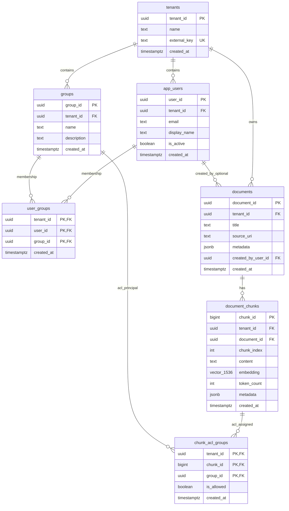

# ER Diagram - ACL Semantic Search Schema

This diagram reflects the current DDL in `sql/001_schema.sql`.

## Relationship Notes

- `user_groups` is the tenant-scoped many-to-many bridge between `app_users` and `groups`.
- `chunk_acl_groups` is the tenant-scoped many-to-many bridge between `document_chunks` and `groups`.
- `documents.created_by_user_id` is nullable, so a document may exist without a creator user (`ON DELETE SET NULL`).
- `document_chunks.embedding` stores dense vectors (`VECTOR(1536)` in PostgreSQL).

## Key Constraints (Important for Isolation)

- `app_users`: `UNIQUE (tenant_id, user_id)`, `UNIQUE (tenant_id, email)`
- `groups`: `UNIQUE (tenant_id, group_id)`, `UNIQUE (tenant_id, name)`
- `documents`: `UNIQUE (tenant_id, document_id)`
- `document_chunks`: `UNIQUE (tenant_id, chunk_id)`, `UNIQUE (tenant_id, document_id, chunk_index)`
- `user_groups`: `PRIMARY KEY (tenant_id, user_id, group_id)`
- `chunk_acl_groups`: `PRIMARY KEY (tenant_id, chunk_id, group_id)`

These composite keys and tenant-scoped foreign keys are what enforce clean multi-tenant boundaries.
